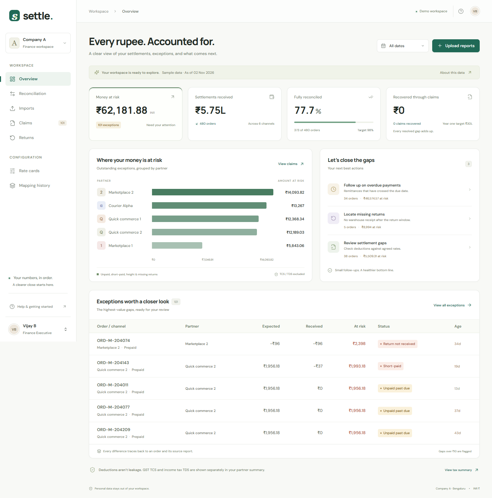

# Settle

[Public GitHub repository](https://github.com/Vijay-1807/settle-reconciliation) · Commit history is preserved for review.

Settle helps a finance team check whether each order was paid correctly. Upload partner reports, review the differences, and export the evidence needed to follow up.

- Portfolio: [vijaybontha.vercel.app](https://vijaybontha.vercel.app/)
- LinkedIn: [bonthavijay](https://www.linkedin.com/in/bonthavijay)
- GitHub: [Vijay-1807](https://github.com/Vijay-1807)

## Start

```sh
npm ci
npm run build
npm run dev
```

Open http://localhost:3000. Node.js 22.13+ is required (built-in SQLite).

Finance executive: `finance@demo.settle`  
Co-founder: `founder@demo.settle`  
Demo password for both: `demo-settle`

These accounts use made-up data. A real customer rollout would need proper account management before accepting financial reports.

## Included

- Seven workspace screens and sign-in, with responsive CSS and mobile navigation.
- CSV/XLS/XLSX upload, source-specific mappings, 20-row preview and explicit approval.
- A small local model suggests column mappings from header names. Staff must check the preview before saving. Unclear mappings need manual input.
- Rules calculate expected payments and flag gaps over ₹10. TCS and TDS are shown separately.
- Claims can be tracked and exported with their source rows and calculations.
- Channel rate cards editable by the co-founder, mapping version history and rollback.
- Courier weight slabs, warehouse receipt checks, and a review queue for missing order IDs.
- Partial payouts can be added without counting the same report twice.
- Import records and mapping history are saved together. If the save fails, neither is kept.
- SQLite persistence, HTTP-only session cookies, origin checks, role enforcement and input validation.
- Synthetic seed orders, including the three supplied examples.

## Verify

```sh
npm test
npm run test:e2e
npm run benchmark
npm run benchmark:import
```

The recorded local check processed 100,000 CSV rows in 5.3 seconds. That includes parsing, validation, database writes, matching and totals. It does not include network transfer or browser rendering. The assumptions and remaining work are explained in the technical document.

Playwright uses installed Google Chrome locally, runs desktop and iPhone-sized Chromium projects, and creates an isolated SQLite database for each test run. GitHub Actions installs Chromium and runs the same suite on Linux. `npm run build` must succeed before browser tests.



## Source guide

`src/engine.mjs` contains financial rules and the mapping model. `src/api.mjs` implements authenticated operations. `src/client.js` contains the UI. `public/style.css` is the design system. `src/local.mjs` adapts SQLite and HTTP for local use; `src/worker.mjs` adapts the same API for Workers. `drizzle/` contains schema-only migrations. `tests/` covers rules and database-backed API behavior.

Design references reviewed: [21st.dev](https://21st.dev/) and [MotionSites](https://motionsites.ai/). The interface is original application code; no proprietary template source was copied. Icons: Lucide. Fonts: DM Sans and Manrope, self-hosted through Fontsource. Spreadsheet parser: [official SheetJS 0.20.3](https://docs.sheetjs.com/docs/getting-started/installation/nodejs/).

## Submission status

The repository is public and includes the commit history. The submission ZIP contains only the technical design PDF and `deployment.md`. The full app runs locally with the demo accounts above. There is no live hosted version; the brief makes hosting optional.

See the [submission checklist and suggested note](docs/submission-checklist.md) before uploading.
